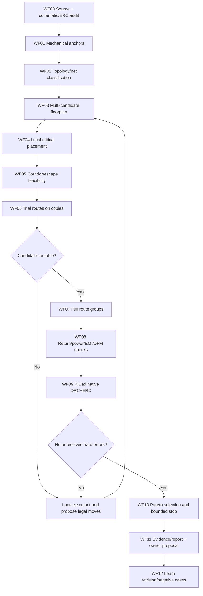

# Quy trình placement → routing học từ 36 reference design

> **Research proposal v1 — 2026-11-16.** Chưa được chủ repo phê duyệt làm rule chính thức, không chạy native KiCad DRC/ERC hay autorouter trong đợt trích xuất này. Phụ thuộc [GOVERNANCE.md](../GOVERNANCE.md). `main` và tất cả file PCB người dùng **không bị sửa**.

## Mục tiêu, phạm vi và kết luận có thể kiểm chứng

Đã rà soát **36/36 nguồn** trong `references/index.json` và đưa từng source vào một phân hệ/chuỗi kiểm tra cụ thể. Cấu trúc có thể triển khai được ngay ở mức **kế hoạch và đánh giá ứng viên**, chứ **không chứng minh 36 layout tối ưu**.

- **10/36** nguồn có file CAD text **đã trực tiếp mở và đọc một phần metadata** trong quá trình kiểm tra (RD24, RD25, RD26, RD27, RD28, RD30, RD31 Eagle, RD32, RD35, RD36). RD36 là case âm tính: file main PCB chưa route.
- **2/36** có vị trí blob PCB xác nhận nhưng connector không đọc được nội dung CAD lớn (RD33, RD34); không giả vờ đã phân tích pad/trace.
- **24/36** còn ở cấp guide/layout-image/project artifact/metadata theo catalog; đây là nguồn định hướng và hypotheses chứ **không được xác minh geometry trong đợt này**.
- Một số board có **nhiều revision**, ví dụ RD25/26. Phải pin revision, SHA, không trộn các file của nhiều đời.
- Mọi phép đo **số segment và tổng chiều dài copper** chưa thể dùng trực tiếp làm DRC, signal integrity hay loop area.

### Bằng chứng mới từ CAD

1. **RD24** Olimex ESP32-S3 Rev B: KiCad source blob `d570de38...`, 64 footprint, 1324 segment, 128 via, 89 zone objects. ESP32-S3-WROOM-1 (U4) có USB_D−/USB_D+ ở GPIO19/20; charger U1 có VBAT/+5V. **Rule ứng dụng:** ưu tiên phân khối antenna, charger/battery, USB và MCU theo topology; không copy spacing chưa đo.
2. **RD25** Olimex ESP32-POE **Rev B1** (không phải revision mới nhất): blob `943faf08...`, 123 module, 2429 segment, 176 via, 12 zone. Dùng cho **bài toán revision-diff và thermal/PoE**, không suy ngay rằng thay đổi lớp tự giải quyết EMI.
3. **RD26** Olimex ESP32-GATEWAY Rev I: blob `ebff1065...`, 111 footprint, 1934 segment, 287 via, 19 zone. Có LAN8710A, ESP32-WROOM, CH340, regulator TPS62A02. **Rule:** chia nhóm PHY–clock–power–MCU, kiểm tra return và nhiễu thay vì chỉ giảm airwire.
4. **RD27** Olimex STM32WL DevKIT Rev D1: blob `47376b4a...`, 69 footprint, 739 segment, 137 via. **Rule:** RF/module + sensors, pin escape và giữ vùng return; chưa xác nhận matching geometry.
5. **RD28** Olimex ESP32 DevKit-LiPo Rev D: blob `cff1fae4...`, 56 footprint, 1221 segment, 108 via. **Rule:** phân nhóm LiPo power path và module/antenna trước signal thông thường.
6. **RD30** STM32F4+MP2359+ESD, blob `abc62424...`: J5 USB → U3 USBLC6 → U2 STM32, cặp USB qua protector ở F.Cu, không via; BUCK_SW/FB topology đã xác nhận. **Không** coi copper length là hot loop area.
7. **RD31** Adafruit ESP32-S3 Eagle blob `e5267ed7...`: board XML **47 elements, 42 signals**; chưa có parser pad-global KiCad; không gộp vào kết quả KiCad 5/9/10.
8. **RD32** SparkFun USB-C soft switch: blob `ea9c01bf...`, 61 footprint, 284 segment, 55 via; J1 VBUS=VIN, J2 VBUS=VOUT, D+/D− tương ứng thông qua board, Q3 tham gia switch power. **Rule:** connector data corridor và VBUS current switch là hai topology khác nhau, không buộc D+/D− đi qua phần switch.
9. **RD35** LibreSolar MPPT 1210: blob `c46b9b10...`, 135 footprint, 1023 segment, 212 via; U1 LM5109B gate driver, L1 SW_NODE → DCDC_OUT, Q1/Q4 power FET. **Rule:** dựng đồ thị switching stage và dòng hồi trước khi rút trace/đặt shunt/AFE.
10. **RD36** STM32F401 KiCad main: blob `f7bb50a8...`, 39 footprint, **0 segment, 0 via, 0 zone**; chỉ dùng làm placement/negative benchmark, không dùng làm mẫu routing hoàn chỉnh chỉ dựa trên README.

> Các con số trên là metadata của **file/revision được đọc**, không phải hiệu năng. KiCad zone count là số *zone objects*, không đồng nghĩa số island hay pour hợp lệ.

## 13 bước đề xuất, tự tối ưu liên tục



| Phase | Tác vụ | Action first | Nếu thử nghiệm không thành công |
|---|---|---|---|
| **WF00** | Source identity, schematic integrity and ruleset | record PCB/SCH/PRO/rulebook SHA and KiCad version | Continue generating review and candidate plans in an isolated copy, mark NEEDS_EVIDENCE; never certify until resolved |
| **WF01** | Mechanical anchor and movement-envelope planning | fix true mechanical anchors only | Try alternative legal connector translation/functional-block orientation; retain immutable locked anchors |
| **WF02** | Build electrical-topology dependency graph | map supply-pin/decoupler local loops, input/filter/AFE/ADC chains, ESD-port-PHY, switching hot loops, MOSFET gates, RF matching, differential pair and ground returns | Unknown nets remain NEEDS_EVIDENCE; optimize independent known blocks while preserving unknown paths |
| **WF03** | Generate multiple board-level candidate placements | generate placement variants by legal rotation, translation and block permutations | Keep the best legal candidate and generate locally perturbed alternatives; never declare 'no solution' due to a single failed attempt |
| **WF04** | Electrical-critical local placement and escape precheck | close switch + input bypass current loop using topology-specific copper path | Adjust only the local functional group, recalculate return path, or choose another candidate; don't push critical parts away just to obtain a short ordinary signal |
| **WF05** | Predict congestion and mark routing corridors | build corridor occupancy/crossing/fanout feasibility map using global pad positions and copper geometries | Emit proposed local component shifts, orientation changes or alternative layer topology and retry WF03–WF05 |
| **WF06** | Trial-route constrained net groups on clones | route clock/critical analog, power hot loops, USB/differential nets and constrained escapes as appropriate | Try alternative route order, scoped rip-up and another legal placement; if tools unavailable return an executable plan with honest NOT_RUN status |
| **WF07** | Route full PCB in dependency-aware groups | choose net-group order based on conflicts and criticality rather than alphabetic list | Retry affected group with alternate ordering; widen movement envelope of movable groups; never delete all existing valid routes indiscriminately |
| **WF08** | Power/ground/EMI/DFM spatial review | refill copper zones and inspect connectivity/return continuity/islands | Propose local copper/placement changes and return to WF04–WF07; log remaining NEEDS_EVIDENCE conditions |
| **WF09** | Native KiCad checks and source consistency | run native KiCad ERC and DRC on exact candidate | No silent bypass: return to earliest cause stage with localized repair recipe; when KiCad unavailable label NOT_RUN and keep candidate unreleased |
| **WF10** | Select Pareto-improving legal candidate and stop bounded search | discard violating candidates but retain learnings | Report best known candidate and pending risks with next actionable experiment; NEVER claim global optimum from finite search |
| **WF11** | Produce auditable deliverables and user-controlled upstream proposals | save board outputs and before/after metrics with source and rulebook hashes | Deliver partial verified artifacts and explicit gaps rather than block all useful reports |
| **WF12** | Learn from real hardware revisions and negative cases | compare before/after of same-board revisions with changes in netlist, layer count, thermal, return and EMC outcomes | Keep evidence as draft or inconclusive and continue collecting; don't force a rule from incomplete data |

### Nguyên tắc không block tiến trình

Không dừng toàn bộ dự án khi một ứng viên thất bại. **Loại bỏ ứng viên sai**, không xóa PCB gốc hay hủy hết các route đã đúng. Luôn có phản hồi:

```
candidate placement -> corridor map -> trial route -> native checks
                          ^                   |
                          |                   v
             local move / rotate / order change / scoped reroute
                          |
                    preserve best-so-far
```

Khi thiếu KiCad native hoặc dữ liệu điện: vẫn **tiếp tục được** các tác vụ trích xuất, phân nhóm, đề xuất placement, phát hiện nghẽn và tạo kế hoạch cụ thể. Nhưng không được đánh dấu `PASS` cho DRC chưa chạy, không được phát hành PCB khi còn vi phạm cứng. Các trạng thái: `PASS`, `FAIL_CANDIDATE`, `NOT_RUN`, `NEEDS_EVIDENCE`.

**Ngân sách đề xuất, không phải luật vật lý:** tối đa 8 candidate mỗi vòng; 20 lần local placement; 4 thứ tự trial routing mỗi candidate; 12 vòng repair hậu routing; dừng khi 4 vòng liên tiếp không cải thiện. Điều chỉnh theo độ phức tạp board/compute budget; lưu best-so-far. Nếu chưa tối ưu được, báo **best feasible found**, không tuyên bố global optimum.

### Quy tắc đặt cạnh nhau / tránh xung đột

- Đặt **mechanically fixed** theo vỏ, giao tiếp và vùng cấm; **edge-constrained ≠ XY-locked**.
- Đặt **electrically coupled** (CIN→switch/GND, MCU→decoupling return, port→ESD→PHY, CT filter→AFE→ADC, gate driver→Rg→MOSFET) theo loop/path topology chứ không theo tâm linh kiện.
- Dành vùng **movement slack đúng nơi dự đoán nghẽn**. Chừa trống ở góc khác board không cứu được hành lang UART bị R3 cản.
- Phát hiện route đứt layer/detour do unrelated passive → thử **dịch nhóm linh kiện ít critical** trước. Không tự chuyển VCAP, crystal, RF matching hoặc input bypass như một resistor RESET bình thường.
- Net groups được route theo hậu quả kỹ thuật và xung đột thực tế, không ép một thứ tự cố định power trước USB hay cấm mọi via.
- So sánh thành công bằng **full connectivity + DRC + critical return/loop + via/path + DFM + giữ manual edits**. DRC=0 một mình chưa đủ.

### Ví dụ tối ưu nhỏ trên Training

Nguồn PCB trong nhánh main: U2 CH340C ↔ U1 STM8; R3 RESET 10k nằm trong hành lang routing UART; `/UART_RX` đã có **2 via**, `/UART_TX` **0 via**. C2 thuộc CH340C `V3`; C4 thuộc STM8 `VCAP`.

Thử nghiệm có thể tái lập: (1) clone PCB + hash; (2) giữ nguyên U1/U2 và C2/C4; (3) đề xuất 4 vị trí hợp lệ cho R3 ngoài corridor; (4) route lại chỉ UART_RX/UART_TX và NRST liên quan; (5) refill zones + KiCad DRC + kiểm tra không tăng rủi ro reset/return; (6) xếp hạng và lưu candidate. Nếu 2 via vẫn không giảm, không kết luận "R3 không cản" từ một thử nghiệm; kiểm tra pad escape, trace hàng xóm và thứ tự via tiếp. **Bước route thật chưa thực hiện**.

## 36 source → case study/algorithm mapping


### Switching power / high-current

| Ref | Source / design | Evidence | Placement & routing check |
|---|---|---|---|
| **RD01** | TI TPS62933 synchronous buck 2-layer | visual layout inspected | PT02, TC03, TC04 → WF02, WF03, WF04, WF07, WF08, WF10, WF11 |
| **RD02** | TI TPS62933 single-layer EMI example | visual layout inspected | PT02, TC03 → WF02, WF03, WF04, WF07, WF08, WF10, WF11 |
| **RD15** | TI TIDA-01385 – CT energy harvesting + supercapacitor + boost | artifact listed | PT02, PT11 → WF02, WF03, WF04, WF07, WF08, WF10, WF11 |
| **RD20** | Microchip EV-MCP8048 – 2-layer high-current BLDC driver | artifact listed | PT02, PT13 → WF02, WF03, WF04, WF07, WF08, WF10, WF11 |
| **RD23** | Microchip ADM00821 – MIC4684 2A buck EVM | artifact listed | PT02 → WF02, WF03, WF04, WF07, WF08, WF10, WF11 |
| **RD29** | TI TPS62A03EVM-028 – compact buck EVM | artifact listed | PT02, PT06 → WF02, WF03, WF04, WF07, WF08, WF10, WF11 |
| **RD34** | Libre Solar MPPT-2420-HC – buck/MPPT 20A + CAN | CAD listed / unread | PT01, PT02, PT08, PT14 → WF02, WF03, WF04, WF07, WF08, WF10, WF11 |
| **RD35** | Libre Solar MPPT-1210-HUS – 10A solar charge + dual USB | CAD metadata | PT02, PT08, PT15 → WF02, WF03, WF04, WF07, WF08, WF10, WF11 |

### AFE / CT / ADC / isolation

| Ref | Source / design | Evidence | Placement & routing check |
|---|---|---|---|
| **RD05** | Analog Devices EVAL-AD5940BIOZ Rev B (impedance 4-wire) | visual layout inspected | PT11, TC09 → WF02, WF03, WF04, WF07, WF08, WF09, WF11 |
| **RD06** | Analog Devices EVAL-AD5940ELCZ Rev A | artifact listed | PT11, TC09 → WF02, WF03, WF04, WF07, WF08, WF09, WF11 |
| **RD10** | TI TIDA-010243 – three-phase CT energy meter | visual layout inspected | PT13, PT14, TC09 → WF02, WF03, WF04, WF07, WF08, WF09, WF11 |
| **RD11** | TI TIDA-010986 – Rogowski coil active integrator (3 pha) | visual layout inspected | PT13, TC09 → WF02, WF03, WF04, WF07, WF08, WF09, WF11 |
| **RD12** | TI TIDA-00835 – precision energy measurement CT/Rogowski | artifact listed | PT11, PT13 → WF02, WF03, WF04, WF07, WF08, WF09, WF11 |
| **RD13** | TI TIDA-00454 – CT and line voltage energy meter | artifact listed | PT11, PT14 → WF02, WF03, WF04, WF07, WF08, WF09, WF11 |
| **RD14** | TI TIDA-010065 – isolated analog voltage/current input | artifact listed | PT14, TC09 → WF02, WF03, WF04, WF07, WF08, WF09, WF11 |
| **RD19** | Microchip ADM01097 – MCP3564 precision 24-bit ADC board | artifact listed | PT03, PT11 → WF02, WF03, WF04, WF07, WF08, WF09, WF11 |
| **RD21** | Microchip EV55U36A – MCP37D21 80Msps ADC board | artifact listed | PT03, PT07, PT11 → WF02, WF03, WF04, WF07, WF08, WF09, WF11 |

### RS485 / USB / ESD

| Ref | Source / design | Evidence | Placement & routing check |
|---|---|---|---|
| **RD16** | TI TIDA-00862 – RS485 full duplex 2-wire | artifact listed | PT15 → WF01, WF02, WF04, WF05, WF07, WF08, WF09, WF11 |
| **RD17** | TI TIDA-00060 – extended-common-mode RS485 | artifact listed | PT15 → WF01, WF02, WF04, WF05, WF07, WF08, WF09, WF11 |
| **RD18** | TI TIDA-00057 – isolated RS485 (ISO35T) | artifact listed | PT14, PT15 → WF01, WF02, WF04, WF05, WF07, WF08, WF09, WF11 |
| **RD22** | Microchip EV65D44A – USB Power Delivery framework board | artifact listed | PT05, PT07 → WF01, WF02, WF04, WF05, WF07, WF08, WF09, WF11 |
| **RD32** | SparkFun Soft Power Switch USB-C – power gating + USB passthrough | CAD metadata | PT01, PT02, PT05, PT07 → WF01, WF02, WF04, WF05, WF07, WF08, WF09, WF11 |

### MCU / clock / RF / USB / power

| Ref | Source / design | Evidence | Placement & routing check |
|---|---|---|---|
| **RD03** | Espressif ESP32-S3 chip/module | vendor guide read | PT04, PT06, PT07, PT10, TC05 → WF01, WF02, WF03, WF04, WF05, WF07, WF09, WF11 |
| **RD04** | Nordic nRF54L15 DK PCA10156 | artifact listed | PT03, PT10 → WF01, WF02, WF03, WF04, WF05, WF07, WF09, WF11 |
| **RD07** | Raspberry Pi RP2040 Minimal KiCad | artifact listed | PT03, PT07 → WF01, WF02, WF03, WF04, WF05, WF07, WF09, WF11 |
| **RD09** | Espressif development kits (ESP32-S3 and others) | artifact listed | PT01, PT10 → WF01, WF02, WF03, WF04, WF05, WF07, WF09, WF11 |
| **RD24** | OLIMEX ESP32-S3-DevKit-LiPo – ESP32-S3 USB-C+LiPo | CAD metadata | PT01, PT03, PT07, PT10 → WF01, WF02, WF03, WF04, WF05, WF07, WF09, WF11 |
| **RD27** | OLIMEX LoRa-STM32WL-DevKIT – STM32WL RF+I2C sensors | CAD metadata | PT03, PT07, PT10 → WF01, WF02, WF03, WF04, WF05, WF07, WF09, WF11 |
| **RD28** | OLIMEX ESP32-DevKit-LiPo – KiCad power-path board | CAD metadata | PT01, PT03, PT10 → WF01, WF02, WF03, WF04, WF05, WF07, WF09, WF11 |
| **RD31** | Adafruit Feather ESP32-S3 – native USB-C + LiPo + RF | CAD metadata | PT01, PT05, PT07, PT10 → WF01, WF02, WF03, WF04, WF05, WF07, WF09, WF11 |

### Failure and revision comparisons

| Ref | Source / design | Evidence | Placement & routing check |
|---|---|---|---|
| **RD25** | OLIMEX ESP32-POE – KiCad ESP32 Ethernet PoE | CAD metadata | PT02, PT06, PT16 → WF00, WF03, WF05, WF08, WF11, WF12 |
| **RD26** | OLIMEX ESP32-GATEWAY – KiCad Ethernet + Wi-Fi board | CAD metadata | PT06, PT07, PT10, PT16 → WF00, WF03, WF05, WF08, WF11, WF12 |

### Generic placement/routing case studies

| Ref | Source / design | Evidence | Placement & routing check |
|---|---|---|---|
| **RD08** | FEDEVEL custom keyboard (RP2040) | source project linked | PT01, PT08 → WF00, WF03, WF05, WF06, WF07, WF11, WF12 |
| **RD30** | pms67 STM32F4 Reference PCB – STM32F405 + buck MP2359 + USB | CAD metadata | PT02, PT03, PT07 → WF00, WF03, WF05, WF06, WF07, WF11, WF12 |
| **RD33** | Libre Solar BMS-C1 – 16-cell 70–100 A battery management | CAD listed / unread | PT11, PT13, PT14, PT15, PT16 → WF00, WF03, WF05, WF06, WF07, WF11, WF12 |
| **RD36** | STM32F401RE 2-layer USB-C dev board – independent student reference | Unrouted source | PT03, PT04, PT07, PT09 → WF00, WF03, WF05, WF06, WF07, WF11, WF12 |


## Không chuyển giả thuyết thành luật cứng

Những nguồn là **đề xuất cần kiểm nghiệm**, giữ nguyên giá trị exception từng IC. Các rule mới ER01–ER06 và workflow WF00–WF12 **chưa được owner approve**. Datasheet exact MPN/package + topology + stackup + fab luôn ưu tiên hơn demo, blog, video và một PCB chưa đo.

Các reference thuộc nhóm **power/high-current/AFE/isolation** cần datasheet, tiêu chuẩn an toàn, thông số dòng/EMI và sơ đồ cùng revision trước khi phân loại `HARD`. Đặc biệt không suy `crystal càng sát càng tốt`, `mọi trace 90° đều sai`, `0 via là tối ưu`, hay `đủ DRC là đủ tiêu chuẩn điện`.

## Tài liệu và công cụ để Claude/Codex tiếp tục

- [Ma trận 36/36 source, status và checklist](2026-11-16_ALL_36_REFERENCE_MATRIX.json).
- [13-stage workflow machine-readable](2026-11-16_PLACEMENT_ROUTING_WORKFLOW.json).
- [Agent profile planner](../tools/plan_reference_workflow.py).
- [6 geometry-derived ER proposals](2026-11-16_CAD_RULE_CANDIDATES.md).
- [CAD-source extraction runbook](2026-11-16_CAD_EXTRACTION_RUNBOOK.md).

**Chạy trên checkout nhánh nghiên cứu:**

```bash
python tools/plan_reference_workflow.py --validate
python tools/plan_reference_workflow.py --profile mcu-usb --output review/plan_mcu_usb.json
python tools/plan_reference_workflow.py --profile battery-power --output review/plan_power.json
python tools/plan_reference_workflow.py --profile all --output review/plan_all36.json
```

Script chỉ tạo **kế hoạch lựa chọn các reference và thứ tự kiểm tra**, không tạo copper, không hứa DRC. Bước tiếp theo phải thử trên Training, rồi đa dạng board power/USB/analog, ghi before/after thật để calibrate objective và rule.
